# Hey, I'm Luiz! 👋

🎓 Computer Science student at **CESAR School**, based in Recife, Brazil.

💻 Passionate about technology and software development, with a growing interest in **Backend Development, Cloud Computing, DevOps, and Cybersecurity**.

🚀 Currently improving my programming skills, building projects, and looking for my first opportunity as a **Software Development Intern**.

---

### 🛠️ Tech Stack

**Languages & Development**

**Tools & Technologies**

---

<h3>📊 GitHub Stats</h3>

  <picture>
    <source media="(prefers-color-scheme: dark)" srcset="./assets/overview.dark.svg">
    
  </picture>

<h3>📈 Contribution Activity</h3>

  <picture>
    <source media="(prefers-color-scheme: dark)" srcset="./assets/contributions.dark.svg">
    
  </picture>

<h3>💻 Most Used Languages</h3>

  <picture>
    <source media="(prefers-color-scheme: dark)" srcset="./assets/languages.dark.svg">
    
  </picture>

---

### 📫 Let's Connect

